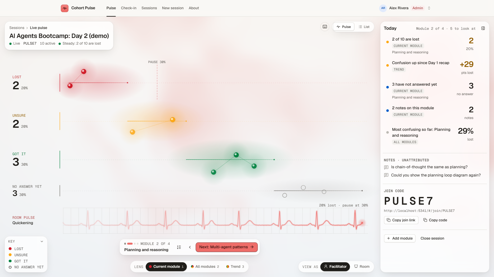

# Cohort Pulse

A one-tap understanding check for virtual training. Participants join with a short code and press **Lost**, **Unsure**
or **Got it** as the session moves through its modules. The facilitator watches the room's heartbeat, gets a calm
"consider pausing" moment when 30 % of the room is lost, and a session report afterwards that ranks modules by
confusion. Privacy by design on screen: the app shows the facilitator totals, never names (see Known limits for what
the database exposes). A Fabric App built by Datachain Consulting for AI @Work.



Demo video (about 2 minutes, AI-generated narration, captions burned in): [demo/out/cohort-pulse.mp4](demo/out/cohort-pulse.mp4) · captions file [demo/out/cohort-pulse.srt](demo/out/cohort-pulse.srt). Re-record with `npx tsx tools/demo/record.ts cohort-pulse` from the repo root.

## What it looks like

**The room's heartbeat.** The home screen draws the room as lights: one light per current answer, drifting in four
bands (lost, unsure, got it, and hollow rings for people who are active but have not answered). Each band stretches
over its share of the room, so the four together are one bar of light pulled apart into rows, and the lost band is
read against a dashed pause line at 30 %. Below them an ECG-style pulse line beats faster as more of the room is lost,
and a WebGL "room light" behind everything warms towards red as confusion nears the line. Lights carry no identity:
they are drawn from totals and reshuffle when totals change.

- **Lenses** (keys 1–3): *Current module* (the bands), *All modules* (a column per module, side by side) and *Trend*
  (a streamgraph of answers over the session; thickness is the number of answers). **View as** (V): *Facilitator*
  or *Room*, which hides notes and the console and shows a big join code for screen sharing.
- **Today** ranks what needs attention (consider pausing, confusion up since the last module, people who have not
  answered, new notes, the most confusing module so far); each item switches lens and focuses the band, module or
  notes behind it. `?` lists every shortcut; Shift+→ / Shift+← move between modules.
- **Tools:** **Pulse** (the facilitator console: conductor for modules, notes, join code), **Check-in** (the
  attendee screen: three big tactile buttons with a press, a ripple and a light that rises when the answer is saved)
  and **Session report** (confusion ranking per module, the session's heartbeat over time, notes per module, copy as
  Markdown, print).
- **Fallbacks:** *List* (L) shows the same totals as tables; without WebGL (or with `?nowebgl`) the room light is
  drawn with CSS gradients and everything else stays; with reduced motion the lights stop drifting and the pulse line
  is drawn once, still.

## 2. Prerequisites

- Microsoft Fabric with the **Fabric Apps** workload enabled for your tenant.
- A workspace on a Fabric capacity, and **Edit** permission (Contributor or higher) on it.
- Node.js 20 or later.
- **Audience.** Deployed apps accept Fabric sign-in (Microsoft Entra ID) only, and every participant needs access to the
  app item. Workspace members get it by default. For outside attendees, invite them as **guests** in your tenant and add
  them to the workspace (Viewer is enough to run the app), or share the app item with them, before the session.
- No other tenant settings are needed (no anonymous data access, no connectors).

## 3. Run locally

```bash
npm install          # once, at the repository root
cd apps/cohort-pulse
npm run dev          # offline demo on http://localhost:5207 with seed data and a persona switcher
npm run dev:fabric   # rayfin dev: the real Fabric-backed services (needs `npx rayfin login`)
```

Demo mode keeps data in the browser (localStorage). Use the identity menu (top right) to switch persona:

| Persona | Role | What to try |
|---|---|---|
| Alex Rivera | Facilitator (admin) | Home is the pulse of "AI Agents Bootcamp: Day 2 (demo)"; Sessions has the report of Day 1 |
| Sam Taylor | Participant | Joined Day 2 but has not answered: one tap on **Lost** fires the alert (3 of 10) |
| Priya Shah | Participant | Said Unsure on Day 2: the screen shows "You said: Unsure, 2 min ago" |
| Jamie Chen | Late joiner | Not in Day 2 yet: joining with code `PULSE7` adds an 11th active participant |

The live session's activity is dated a few minutes before the seed ran, so the pulse shows the seeded state for about
7 minutes; after that the participants fall out of the 10-minute window. **Reset demo data** in the identity menu
re-seeds.

Tests: `npx tsc -b`, `npx vitest run`, `npx vite build --mode demo`, `npx playwright test` (390 px and 1280 px).

## 4. Deploy

```bash
cd apps/cohort-pulse
npx rayfin login
npx rayfin up --workspace-id <your-workspace-id>
npx rayfin up status
```

`rayfin up` builds the Fabric bundle, creates the app backend and SQL database on first run, applies schema changes
(also on later deploys), uploads the site and adds its URL to `allowedRedirectUris`.

## 5. Seed (optional)

Open the deployed app once while signed in (this creates your Person row), then (uses your Azure CLI sign-in):

```bash
cd apps/cohort-pulse
npm run seed:fabric -- --admin-email you@yourorg.com
# or, from the repository root: node tools/seed-fabric.mjs --app cohort-pulse --admin-email you@yourorg.com
```

It inserts, once (an `AppMarker` row `seed:v1` makes it idempotent): 4 demo personas and 11 more fictional participants
as Person rows; a closed session "AI Agents Bootcamp: Day 1 (demo)" (code `AGENT5`) with 5 modules (Agent anatomy, Tools
and actions, Memory, Guardrails, Evaluation), 14 participants, 72 check-ins and 6 notes, where Memory ends with 7 of 14
lost; and an open session "AI Agents Bootcamp: Day 2 (demo)" (code `PULSE7`) with 4 modules, the second one current, 18
check-ins (10 on the finished recap, 8 on the current module) and 10 joins. The seeded sessions belong to the demo facilitator persona, so in Fabric they are visible as
data but only that persona could open their consoles; create your own session to try the console. Dates are relative to
the time you run it.

The admin flag is not needed by this app (any signed-in user can host their own sessions). If you want it anyway:

```sql
UPDATE dbo.People SET isAdmin = 1 WHERE email = 'you@yourorg.com';
```

## 6. How it works

| Entity | Fields | Who can write (row policy) |
|---|---|---|
| `PulseSession` | id, title (3–100), code (6, **unique**), hostSub, hostName, status (`open`/`closed`), currentModuleId?, createdAt, closedAt? | create and update only when `claims.sub == hostSub`; update cannot touch hostSub, code, createdAt; no delete |
| `PulseModule` | id, sessionId, hostSub (denormalised), name (3–80), sortOrder (int), startedAt?, endedAt? | create and update only when `claims.sub == hostSub`; update cannot touch hostSub, sessionId; no delete |
| `CheckIn` | id, sessionId, moduleId, participantSub, level (`lost`/`unsure`/`got_it`), note? (≤140), createdAt | **append-only**: create only when `claims.sub == participantSub`; no update or delete for anyone |
| `PulseJoin` | id, sessionId, participantSub, createdAt | append-only, same as CheckIn |
| `Person`, `AppMarker` | shared identity and seed marker | as generated |

All entities are readable by signed-in users (`@role('authenticated', 'read')`).

**Rules** (thresholds in `src/config.ts`, explained on the About page):

1. A participant's state for a module is their most recent CheckIn for it. Rows are only appended; "latest" is
   resolved on read (`currentStates`).
2. Active = checked in to any module, or joined, in the last **10 minutes** (`activeParticipants`). The pulse shows the
   current states of active participants, plus "No answer yet" for active people who have not answered the current
   module. Percentages use largest-remainder rounding, so they always add up to 100.
3. Alert when at least **3** participants are active and at least **30 %** of them are lost (integer maths, so 3 of 10
   fires and 2 of 10 does not). Fewer than 3 active shows "Waiting for more check-ins".
4. Next/Previous ends the current module (`endedAt`), starts the new one (`startedAt`) and updates `currentModuleId`.
   Participants see the new module with no state carried over. Going back reopens a module fresh: its `startedAt` is
   reset and only check-ins since then count (gauge, "you said", notes and report), so the report shows its last run.
5. The report takes each module's final states at its end, or at close for the module still running, and ranks modules
   by confusion index (share of final states that were lost). Copy as Markdown.
6. Notes are shown to the host unattributed, newest first, under the current module, and per module in the report.
7. The stage's lenses read the same totals: `moduleTotals` (finished modules at their end, the current one from the
   gauge) and `sessionTrend` (answer totals sampled over each module's run). Neither returns a participant id.

**Why a `PulseJoin` entity.** Spec rule 2 counts a join as activity, so a late joiner who has not tapped yet must still
count in the gauge as "No answer yet". A join is recorded when the participant screen first loads (reloads within 1
minute are ignored). A separate append-only entity keeps `CheckIn` meaning exactly "an answer": a check-in-less
presence row would need a nullable level or a fourth fake level, and every gauge, report and note query would have to
filter it out. PulseJoin gets the same owner policy as CheckIn, so nobody can fake someone else's presence.

**Privacy by construction (UI).** The domain functions that feed the host UI (`loadHostConsole`, `loadReport`) return
counts, shares and note text only; participant subs are used for de-duplication inside the pure functions and never
reach a component. The participant screen loads only the viewer's own check-ins. Playwright asserts that no
participant name or id appears anywhere in the text or markup of the host console and both reports.

**What is enforced where.**

| Threat | Enforced by |
|---|---|
| Writing a check-in or join as someone else | Row policy (`claims.sub == participantSub`) |
| Editing or deleting a check-in (rewriting history) | No update/delete permission on CheckIn or PulseJoin |
| Changing someone else's session or module | Row policy on `hostSub` (denormalised onto PulseModule) |
| Taking over a session by changing hostSub or code | `exclude` on update |
| Two sessions with the same code (join hijack) | `unique` constraint on `code`, plus a check before insert |
| Inserting a module into someone else's session with your own hostSub | Domain: modules count only when `hostSub == session.hostSub` |
| Stuffing the gauge | One state per participant (latest wins) and the policy pins participantSub to your own sub |
| Future-dated check-ins to stay "active" | Domain: rows more than 5 minutes ahead of the facilitator's clock are ignored (`FUTURE_SKEW_MS`) |
| Old answers resurfacing when a module is reopened | Domain: only rows since the module's latest `startedAt` count |
| Answering a module the host already left, or a closed session | Domain refuses (`checkIn`); the report ignores rows dated after a module's end plus the 5-minute clock allowance |
| Host-only screens (console, report) | Domain `PermissionError` when `me.sub != session.hostSub` |

## 7. VERIFY outcomes and known limits

- **Owner policies** (`claims.sub.eq(item.hostSub)` / `item.participantSub`) and `exclude` lists: compile with the
  Rayfin 2.0 typed policy DSL, same pattern as the shared Person entity (see `shared/NOTES.md`).
- **Append-only**: expressed by granting `create` and `read` only. The platform accepted these policies on deploy
  (20 Nov 2026); a denied update from a browser session has not been exercised yet.
- **`@text({ unique: true })` on `code`**: verified on the deployed database (`UQ_PulseSessions_code`). The domain
  also checks for a clash before insert, so a duplicate shows a readable message instead of a SQL error.
- **"Totals, not names" holds for the UI only.** The app's screens never show a participant name or id, and the
  join screen says exactly that ("This app shows your facilitator totals, not names."). The database does not hide
  them: every signed-in user of the app can read every CheckIn row (participantSub, level, note) and every Person row
  (sub, displayName, email) through the generated GraphQL API, so joining the two reveals who pressed what and who
  wrote which note. The host needs every CheckIn row to compute the gauge, and the policy DSL cannot serve aggregates
  while hiding rows. The fix is a server-side Function that returns aggregates only, with CheckIn reads closed to
  clients (see Later). Until then, do not promise participants anonymity beyond the screen.
- **Clock skew.** `createdAt` on CheckIn and PulseJoin is the participant's device time. Rows up to 5 minutes ahead
  of the facilitator's clock count (`FUTURE_SKEW_MS` in `src/config.ts`); later ones are ignored. A new check-in is
  never dated before the current module's `startedAt` nor before the participant's own previous check-in, so a slow
  device still counts in a freshly started module and "latest wins" follows tap order. A device far behind can still
  drop out of the 10-minute active window early, and a participant could back-date a check-in through the API.
- **No transactions.** Moving to another module is three writes (end the old module, start the new one, point the
  session at it); closing is two. If one fails, the error shows and the host presses the button again: each step is
  idempotent (an already-ended module keeps its first `endedAt`, the session pointer is written last), covered by the
  "retrying after a failed write" unit tests. Until the retry, the console still shows the old module as current.
  Creating a session writes the session, then its modules; if that stops half-way, add the missing modules on the
  console.
- **The Fabric bundle carries the Rayfin API URL and publishable key.** `rayfin up` writes them to `.env.local` and
  the Fabric build embeds them in the JavaScript bundle, as in every Rayfin app. The URL contains tenant and workspace
  ids. Neither is a secret (data access still needs a Fabric sign-in), but they are visible to anyone who can load the
  app. Nothing of the kind is committed to this repository.
- **No admin or host claim.** "Only the host may open the console" is a UI/domain check; the data is readable by any
  signed-in user as above. Writes are protected by the row policies.
- **Polling, not push.** The console and participant screens refresh every 5 s (no realtime in the SDK).
- **Audience.** Attendees need Fabric sign-in and access to the app item (guests or workspace members).

## 8. Later

- An aggregate-only server-side Function for the gauge and the report, with client reads of CheckIn (and of other
  people's Person rows) closed, so "totals, not names" also holds at the database level.
- A QR code for the join link on the Room view.
- Per-session export of the report as CSV, and trend across sessions of the same course.
- Database-level host enforcement for reads via dynamic auth claims.

## 9. Gallery

- **Title:** 12 Days of Fabric Apps: Day [#] – [Theme]: Cohort Pulse
- **Tag:** Partner | 12 Days of Fabric Apps
- **Blurb (≈70 words):** Know when the room is lost before anyone has to say so. Participants tap Lost, Unsure or Got
  it on three big buttons. The facilitator sees the room's heartbeat: one light per answer in glowing bands, a pulse
  line that quickens with confusion, and a calm prompt to pause when 30 percent are lost. Lenses show every module and
  the trend; the session report ranks modules by confusion. Totals on screen, never names. Built on Fabric Apps.
- **Tags:** training, education, feedback, live, privacy, Fabric Apps, SQL database
